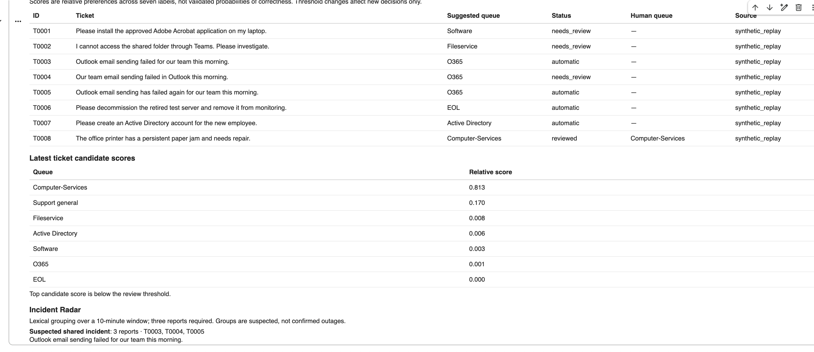

# RouteWise

A support ticket router with human review and a small incident radar.

This started with The Gen Academy's Week 5 project: fine-tune Qwen3-1.7B-Base to send IT
support tickets to the right team. After completing the notebook, I added a desk where
someone can inspect a routing decision, review uncertain requests, and spot related reports.



## What I added

**Human review.** The model suggests a queue and shows its scores for the other queues.
A score cutoff and the gap between the top two queues determine which tickets need review.
A person can confirm or change the queue. The original model prediction stays in the record.

**Incident Radar.** Similar reports within ten minutes are grouped into a suspected incident.
In the demo, three email-failure reports are linked together, including one still waiting
for review. Grouping uses word overlap and a few email-related aliases. It flags a possible
connection; someone still needs to investigate.

**A replay that works without a GPU.** I saved the scores from the actual GPU run and added
a CPU notebook that replays them. It lets someone try the review workflow without downloading
the model. The notebook is clearly marked as recorded replay and cannot classify new tickets.

## Try it

The easiest place to start is
[03_CPU_Replay_of_Recorded_Results.ipynb](notebooks/03_CPU_Replay_of_Recorded_Results.ipynb).

1. Download it and upload it to [Google Colab](https://colab.research.google.com/).
2. Select **None/CPU** as the hardware accelerator.
3. Run the three cells in order.
4. Set the score cutoff to **0.90**, leave the top-two gap at **0.20**, enable the experimental
   policy, and click **Replay 8 recorded tickets**.

The replay starts with four automatic routes and four requests for review. Confirm T0008
as Computer-Services to try the human decision step, then scroll down to Incident Radar.
All eight requests are synthetic examples. Their routing scores came from the trained model.

For new-ticket inference, use
[01_Restore_and_Try_RouteWise.ipynb](notebooks/01_Restore_and_Try_RouteWise.ipynb) with a T4 GPU.
That notebook also needs the original 127.4 MB trained-model backup ZIP, which is separate
from this code package. It restores the adapter and saved tokenizer; it does not repeat training.

## Results

The original run used **468 training tickets and 117 validation tickets** across seven queues.
The notebook's baseline accuracy was **31.6%**, and the tuned model reached **70.1%**.

For the extension, I compared the base and tuned models using the same complete-label scoring
method. The base model got **28/117 correct (23.9%)** and the tuned model got
**82/117 correct (70.1%)**. The baseline differs from the original notebook because its
letter-choice prompt was replaced by the same scoring procedure used for the tuned model.

A fixed TF-IDF plus logistic-regression classifier got **81/117 correct (69.2%)** on the
original split. The tuned model is only one ticket ahead. That is a useful reason to keep
the simpler model in the comparison rather than assume fine-tuning is always the best choice.

The review rule changes how much work is automated:

| Score cutoff | Automatically routed | Correct automatic routes | Sent for review |
| --- | --- | --- | --- |
| 0.80 | 54 of 117 | 46 of 54, or 85.2% | 63 |
| 0.90 | 38 of 117 | 35 of 38, or 92.1% | 79 |

Both rows use a 0.20 top-two gap. These are **exploratory results on the same development
examples used to inspect the thresholds**. The 92.1% figure applies to the accepted 38
tickets, with three wrong routes. It is not the accuracy across all 117 tickets or an
independent test result.

## What still needs work

Active Directory was a weak category: the tuned model correctly identified only 2 of its
9 validation tickets. High scores can also be wrong, so the displayed scores should not
be treated as calibrated probabilities of correctness.

Free generation exposed another issue. All six smoke examples started with the intended
category but continued with unwanted text. The original notebook matched category prefixes;
the extension records those outputs as invalid. The desk uses scores for the seven complete
labels, including the end-of-response token. Those raw failures are kept in the results.

I prepared a second experiment with separate training, calibration, and test partitions.
Colab's GPU usage limit prevented that run, so
[notebook 02](notebooks/02_Train_Calibrate_and_Test_RouteWise.ipynb) is included as unfinished
work. There are no results from it. The next step is to choose the review rule on calibration
data and evaluate it on a separate test set, followed by new, independently reviewed tickets.

Human decisions are saved for later analysis. They do not automatically retrain the model.

## Files

- `routewise/` — scoring, review logic, incident grouping, and notebook controls.
- `notebooks/` — runnable notebooks and saved copies of the completed runs.
- `data/original_results/` — results from the assignment.
- `data/development_results/` — scores, comparisons, and review records from the extension.
- `tests/` — 29 checks for routing, review history, grouping, policy selection, and recorded replay.
- `docs/DEMO_SCRIPT.md` — walkthrough notes.

To run the local logic tests:

```sh
python3 -m unittest discover -s tests -v
```

The live desk and CPU replay were both exercised in Colab. Local tests cover the workflow
logic; they do not establish model accuracy.

## Starting point

The training notebook and dataset came from
[The Gen Academy's Week 5 project](https://github.com/The-Gen-Academy/5A-Fine-Tune-a-Support-Ticket-Router).
RouteWise adds the review desk, complete-label scoring, incident grouping, comparisons,
recorded replay, and tests around that work.
